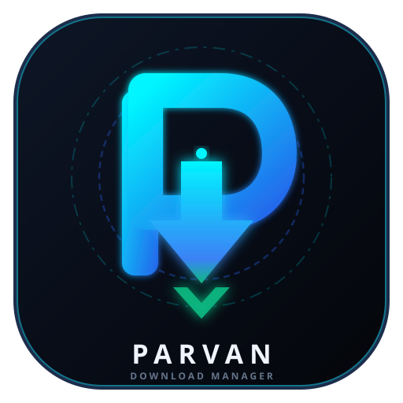

# ⚡ پروان دانلود منیجر (نسخه ۳.۰.۰) | Parvan Download Manager v3.0

<div align="center">
  
  <br>
  <h3>نسل جدید دانلود منیجر دسکتاپ چندکاناله، فوق سریع، ضد تحریم و هوشمند</h3>
  <p>Next-Generation Multi-Threaded Desktop Downloader & Browser Extension (v3.0.0)</p>
</div>

---

## 👥 تیم توسعه و طراحان هسته (Core Team):
- **Ali Hasanifard (علی حسنی فرد)** — معمار سیستم و توسعه‌دهنده اصلی
- **Ehsan Fazlinejad (احسان فضلی نژاد)** — طراح و توسعه‌دهنده
- **Amirmahdi Shahbazi (امیرمهدی شهبازی)** — طراح و توسعه‌دهنده

---

## 🌟 ویژگی‌های برجسته نسخه ۳.۰ (Key Features)

- **🎥 اسنیفر و دانلودر چندرسانه‌ای آنلاین (Native Video/Audio Sniffer):** استخراج و دریافت هوشمند جریان‌های استریم ویدیو/صوت از سایت‌ها (یوتیوب، اینستاگرام، آپارات، تلگرام و توییتر) با رزولوشن‌های متنوع بر پایه هسته `yt-dlp`.
- **🧲 پشتیبانی مستقیم از لینک‌های مگنت و تورنت (Magnet & Torrent Link Parser):** پارس دقیق فراداده، هش اطلاعاتی (URN BTIH)، نام فایل و ترکرهای P2P.
- **🛡️ اسکن امنیتی و آنتی‌ویروس پیش از اجرا (Windows Defender Antivirus Scan):** بررسی خودکار فایل‌های اجرایی با اسکنر سیستمی `MpCmdRun.exe` و صدور وضعیت سلامت (Clean / Infected).
- **⏱️ زمان‌بندی هوشمند و خاموشی خودکار (Smart Scheduler & Auto Shutdown):** دانلود در ساعات شبانه و خاموش کردن خودکار سیستم یا حالت Sleep پس از پایان کار.
- **🛡️ اعتبارسنجی خودکار چک‌سام (SHA-256 Checksum Integrity):** محاسبه هش فایل بلافاصله پس از پایان دانلود جهت تضمین سلامت و عدم دستکاری فایل.
- **📂 استخراج خودکار فایل‌های فشرده (Auto-Extract Archives):** آنزیپ خودکار فایل‌های فشرده (`.zip`) در پوشه تفکیک‌شده بلافاصله پس از اتمام دانلود.
- **⚡ موتور دانلود ۱۶ الی ۳۲ کانکشن همزمان (Multi-Thread Chunks):** تکه‌تکه کردن هوشمند فایل‌ها بر اساس متد استاندارد `Range: bytes` و شتاب‌دهی واقعی تا حداکثر کشش خط اینترنت.
- **🔁 سیستم بازآزمایی و ریکاوری هوشمند (Auto-Retry & Reconnect):** مقاومت کامل در برابر قطعی‌های لحظه‌ای اینترنت با ریکاوری خودکار چانک‌ها بدون نیاز به دانلود مجدد.
- **🚦 محدودکننده نرخ سرعت (Speed Limiter):** کنترل دقیق سقف مصرف پهنای باند از ۱ تا ۱۰۰۰ مگابایت بر ثانیه جهت جلوگیری از اشغال تمام ترافیک شبکه.
- **🛡️ صف واقعی بدون تسک‌های دمو:** محیط کاملاً تمیز بدون هرگونه تسک ساختگی یا غیرواقعی.
- **📊 داشبورد و مانیتورینگ زنده (Live Telemetry):**
  - نمایش **سرعت دانلود خالص (`MB/s`)** به صورت لحظه‌ای
  - نمایش **سرعت اینترنت ورودی خط (`Mbps`)** و راندمان مصرف پهنای باند
  - نمودار دوتایی Real-Time جریان دیتا
- **🌐 پراکسی داخلی ضد تحریم (Anti-Sanction & Proxy Support):** یکپارچه‌سازی با v2rayN روی `127.0.0.1:10808` جهت دانلود سریع و پایدار از سایت‌های مسدود یا تحریم‌شده.
- **🧩 افزونه رسمی مرورگر (Chrome / Edge / Brave Extension):**
  - رهگیری خودکار دانلودهای مرورگر و انتقال خودکار به پروان
  - گزینه منوی راست‌کلیک روی لینک‌ها و تصاویر: «دانلود با پروان»
  - پاپ‌آپ زیبا با مانیتورینگ زنده و ورودی سریع لینک
- **🔔 آیکون کنار ساعت و اعلانات ویندوز (System Tray & Notifications):**
  - کار در پس‌زمینه بدون ایجاد مزاحمت
  - منوی دسترسی سریع (شروع همه، توقف همه، باز کردن پوشه)
  - ارسال اعلان سیستمی (Toast Notification) پس از اتمام هر دانلود
- **📦 بسته نصبی ویزاردی (`Parvan_Setup.exe`):**
  - فایل نصبی شیک و مستقل بدون نیاز به پیش‌نیاز
  - ایجاد میانبر دسکتاپ و منوی استارت
  - ثبت در لیست برنامه‌های ویندوز (Uninstall Support)
- **🎨 طراحی لوکس OLED Dark Tech:**
  - تم اختصاصی مطابق اصول استانداردهای روز UI/UX
  - دوزبانه (پشتیبانی کامل از فارسی و انگلیسی)
  - افکت‌های صوتی تعاملی سینتی‌سایزر (Audio Synthesizer)

---

## 🚀 راهنمای نصب و اجرا

### ۱. استفاده از فایل نصبی (پیشنهادی برای کاربران)
کافی است فایل **`Parvan_Setup.exe`** را اجرا کنید و در چند ثانیه برنامه را نصب و اجرا نمایید.

### ۲. نصب افزونه روی مرورگر (Chrome / Edge)
1. مرورگر خود را باز کرده و به آدرس `chrome://extensions` یا `edge://extensions` بروید.
2. گزینه **Developer mode (حالت برنامه‌نویس)** را در گوشه صفحه فعال کنید.
3. دکمه **Load unpacked (بارگذاری بسته باز شده)** را بزنید.
4. پوشه `browser-extension` موجود در این مخزن را انتخاب کنید.
5. آیکون پروان به تولبار مرورگر اضافه خواهد شد!

---

## 🛠️ ساختار پروژه (Architecture)

```text
parvan-download-manager/
├── app.py                  # سرور مرکزی، بریج API و لانچر ویندوز و System Tray
├── engine.py               # موتور اصلی دانلود چندکاناله، چانک‌ها و مدیریت دانلودها
├── index.html              # رابط کاربری مدرن دسکتاپ (HTML5, Canvas, Modern CSS)
├── installer.py            # سورس برنامه نصب ویزاردی ویندوز
├── browser-extension/      # افزونه رسمی مرورگر (Manifest V3)
│   ├── manifest.json
│   ├── background.js       # سرویس ورکر رهگیری دانلودها و راست‌کلیک
│   ├── popup.html          # ظاهر پاپ‌آپ افزونه
│   ├── popup.css
│   ├── popup.js
│   └── icons/              # آیکون‌های افزونه
├── logo.svg                # فایل وکتور لوگوی اختصاصی پروان
├── logo.png                # نسخه باکیفیت لوگو
└── icon.ico                # آیکون استاندارد نرم‌افزار ویندوز
```

---

## 👤 توسعه‌دهنده (Author)
- **علی حسنی‌فرد (Ali Hasanifard)**
- GitHub: [@alihasanifard-web](https://github.com/alihasanifard-web)
